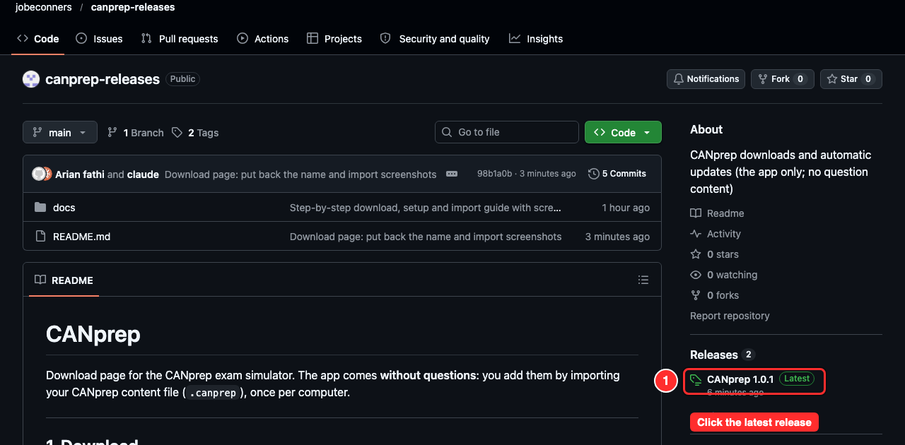
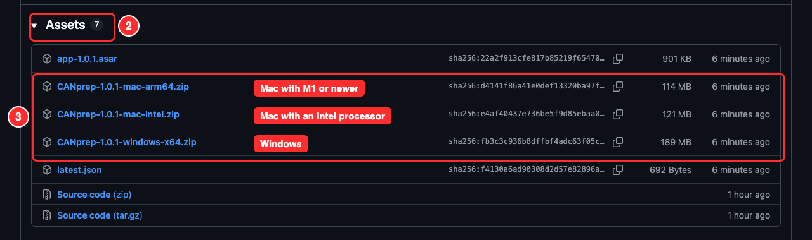
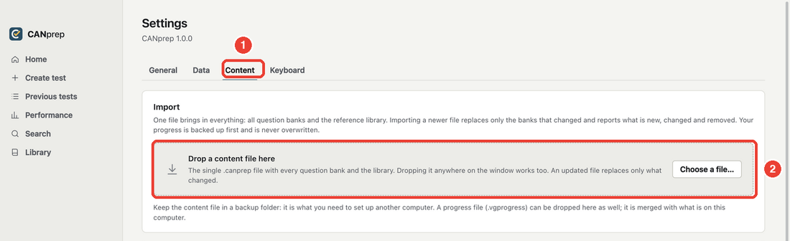

# CANprep

CANprep is a practice-question app for your computer. Setting it up takes about 5 minutes:

1. **Download** the app from this page.
2. **Open** it. Your computer asks you to confirm the first time.
3. **Type your name.**
4. **Add the questions** from your question file.

The app does not come with questions. They come in a separate **question file** (its name ends in `.canprep`) that you
get from the person who shared this page with you. The app calls it the "content file".

---

## Step 1: Download the app

**First, check which computer you have:**

- **Windows PC:** you need the Windows download.
- **Mac:** click the Apple menu (top-left corner of the screen), then **About This Mac**.
  - If it says **Chip: Apple M1** (or M2, M3, M4…), you need the **Apple silicon** download.
  - If it says **Processor** and mentions **Intel**, you need the **Intel** download.

**Then download it:**

1. Go to the **[latest release](https://github.com/jobeconners/canprep-releases/releases/latest)**. If you are on the
   main GitHub page, click the release under **Releases** on the right.

   

2. On the release page, scroll to the bottom to **Assets**. If you don't see a list of files there, click the word
   **Assets** to open it.
3. Click the **one** file for your computer. It downloads to your **Downloads** folder.

   | Your computer | Click this file |
   | --- | --- |
   | Mac with Apple M1, M2, M3, M4… | `CANprep-…-mac-arm64.zip` |
   | Mac with Intel | `CANprep-…-mac-intel.zip` |
   | Windows | `CANprep-…-windows-x64.zip` |

   Ignore the other files. They are for automatic updates.

   

## Step 2: Open the app for the first time

The first time you open CANprep, your computer shows a warning because the app is not from the App Store or the
Microsoft Store. This is normal. Follow the steps for your computer:

- [Windows](#windows)
- [Mac with Apple silicon (M1 or newer)](#mac-with-apple-silicon-m1-or-newer)
- [Mac with an Intel processor](#mac-with-an-intel-processor)

### Windows

1. Open your **Downloads** folder. Right-click the CANprep zip file, choose **Extract All…**, then click **Extract**.
2. A new folder opens. Keep this folder (the app lives in it). You can move it to **Documents** if you like.
3. Open the **CANprep-win32-x64** folder inside it. You will see many files. Double-click the one called **CANprep**
   with the CANprep icon (it may show as **CANprep.exe**).
4. If a blue box says **"Windows protected your PC"**, click **More info**, then **Run anyway**.

Tip: right-click **CANprep** and choose **Pin to Start** so it is easy to find next time.

### Mac with Apple silicon (M1 or newer)

1. Open your **Downloads** folder and double-click the CANprep zip file. (If you already see a **CANprep** app there,
   your Mac unzipped it for you.)
2. Drag **CANprep** onto **Applications** in the left sidebar of the Finder window.
3. Open **Applications** and double-click **CANprep**. A message says Apple could not verify CANprep. Click
   **Done**. Do **not** click "Move to Trash".
4. Click the Apple menu → **System Settings** → **Privacy & Security**. Scroll all the way down and click
   **Open Anyway** next to the message about CANprep.
5. Confirm with your Mac password or Touch ID. If asked again, click **Open Anyway** or **Open**.

On older Macs, step 4 is called **System Preferences → Security & Privacy**. You can also right-click CANprep and
choose **Open**, then **Open** again.

**If it says CANprep "is damaged and can't be opened":**

1. Press **Command + Space**, type **Terminal**, and press **Return**.
2. Copy the line below, paste it into the Terminal window (**Command + V**) and press **Return**. Nothing seems to
   happen. That is normal.

   ```bash
   xattr -cr /Applications/CANprep.app
   ```

3. Close Terminal and open CANprep again.

### Mac with an Intel processor

1. Open your **Downloads** folder and double-click the CANprep zip file. (If you already see a **CANprep** app there,
   your Mac unzipped it for you.)
2. Drag **CANprep** onto **Applications** in the left sidebar of the Finder window.
3. Open **Applications** and double-click **CANprep**. A message says Apple could not verify CANprep. Click
   **Done**. Do **not** click "Move to Trash".
4. Click the Apple menu → **System Settings** → **Privacy & Security**. Scroll all the way down and click
   **Open Anyway** next to the message about CANprep.
5. Confirm with your Mac password or Touch ID. If asked again, click **Open Anyway** or **Open**.

On older Macs, step 4 is called **System Preferences → Security & Privacy**. You can also right-click CANprep and
choose **Open**, then **Open** again.

**If it says CANprep "is damaged and can't be opened":**

1. Press **Command + Space**, type **Terminal**, and press **Return**.
2. Copy the line below, paste it into the Terminal window (**Command + V**) and press **Return**. Nothing seems to
   happen. That is normal.

   ```bash
   xattr -cr /Applications/CANprep.app
   ```

3. Close Terminal and open CANprep again.

You only need to do Step 2 once. After that, CANprep opens like any other app.

## Step 3: Type your name

CANprep asks what to call you. Type your name **(1)** and click **Continue (2)**. There is no account and no password.


## Step 4: Add the questions

After you click Continue, CANprep shows **"No question bank is installed yet"** with a box that says **"Drop your
content file here to begin"**. This is where you add the questions.

1. Find your question file (the one ending in `.canprep`). It is usually in your **Downloads** folder.
2. Drag it into that box. Or click **Choose a file…** and pick it.

   

3. Wait while it loads. When the list of question banks appears, click **Done**. You're ready to study.

   

**Can't find the box?** Click **Home** at the top of the left sidebar. You can also click **Settings** (bottom of the
left sidebar), then the **Content** tab.

Keep the question file somewhere safe. You need it again if you set up CANprep on another computer.

---

## Later

**New or fixed questions:** when you get a newer question file, click **Settings** (bottom left) → **Content (1)**
and drop the file into the box **(2)**. Your answers, notes, flags and highlights are kept.



**App updates:** nothing to do. The app updates itself.

**Updating to version 1.1.0 (the study plan): import the question file once more.** The new study plan uses a map of
the concepts each question tests, and that map comes in the newest question file
(`CANprep-content-2026112020.canprep` or later). After the app has updated, drop that file into Settings → Content
as above. Until you do, the app shows a short reminder on Home and the plan still works, with fewer "second
questions" on what you met before. Your answers, notes, flags, notebook and plan are kept.

**Moving to another computer:** in CANprep, click **Settings** → **Data** → **Export progress**. This saves one file.
Set up CANprep on the new computer (Steps 1 to 4), then drop that file onto the CANprep window. Your progress is
added; nothing is lost.
