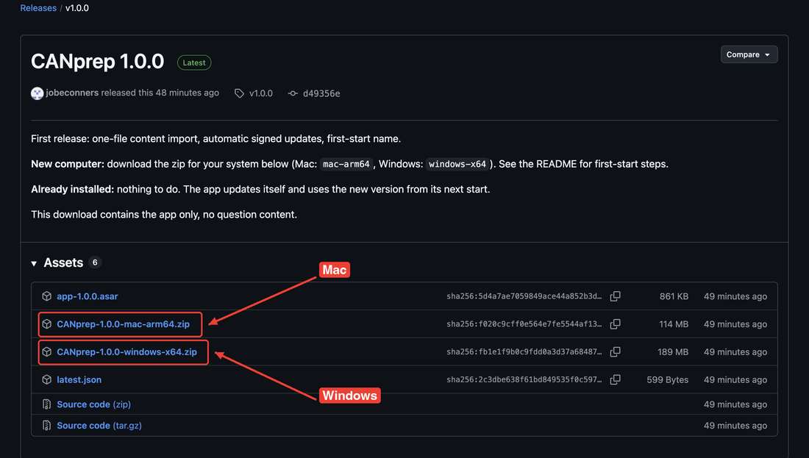
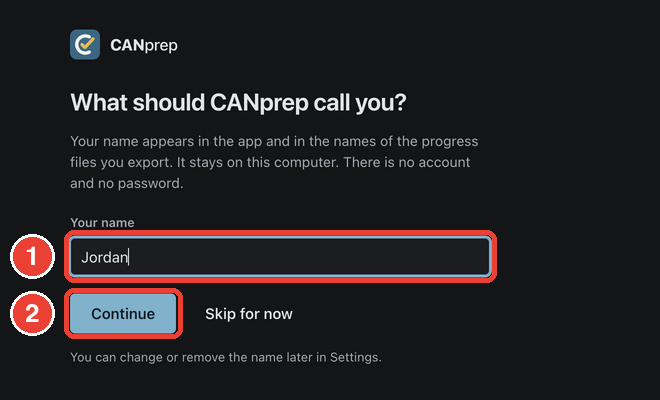
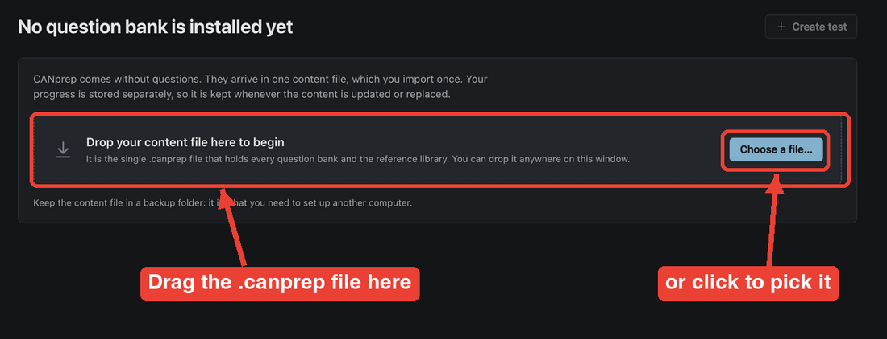
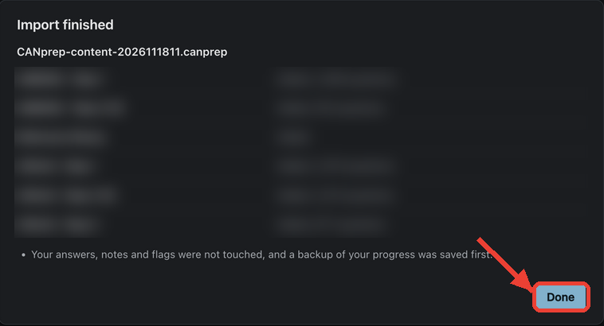

# CANprep

Download page for the CANprep exam simulator. The app comes **without questions**: you add them by importing your
CANprep content file (`.canprep`), once per computer.

---

## 1. Download

Open the **[latest release](../../releases/latest)** and click the zip for your computer under **Assets**:

- **Mac** (Apple silicon): `CANprep-<version>-mac-arm64.zip`
- **Windows**: `CANprep-<version>-windows-x64.zip`

The other files on that page are for automatic updates; you don't need them.

## 2. Install and open

**Mac**
1. Double-click the zip, then drag **CANprep** into your **Applications** folder.
2. First time only: **right-click CANprep → Open → Open**. (macOS asks because the app is not from the App Store.
   If it still won't open: **System Settings → Privacy & Security → Open Anyway**.)

**Windows**
1. Right-click the zip → **Extract All…**, and keep the folder somewhere permanent (e.g. Documents).
2. Open the folder and double-click **CANprep.exe**. First time only: if you see "Windows protected your PC",
   click **More info → Run anyway**.

## 3. Enter your name

Type the name the app should use **(1)** and click **Continue (2)**. It stays on this computer: there is no
account and no password. You can change it later in Settings.

## 4. Import the content file

Drag your `.canprep` file onto the window, or click **Choose a file…** and pick it. You can drop it anywhere on the
window.

It takes a few seconds. A report lists every question bank that was added; click **Done** and start studying.

Keep the content file somewhere safe: you need it again to set up another computer.

---

## Getting new or fixed questions later

When you get a newer content file, import it the same way: drop it on the window, or go to **Settings** (bottom
left) → **Content (1)** → drop it on **Import (2)**. Only the banks that changed are replaced and nothing is
duplicated. The report shows what is new, changed or removed. Your answers, notes, flags and highlights are kept,
and your progress is backed up before every import.

## App updates

Nothing to do. The app checks this page by itself, downloads new versions in the background and uses them from the
next start. Every update is signed, and the app refuses anything that isn't. Updates never touch your progress or
your questions.

## Moving your progress to another computer

**Settings → Data → Export progress** saves one file with everything you've done. On the other computer, drop that
file on the window: it is merged in, nothing is overwritten.
